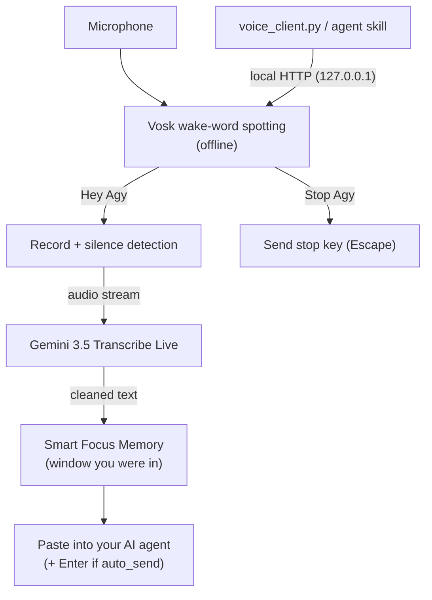

# 🎙️ Hey Agy — "Hey Siri" for AI Agents

[](https://www.python.org/downloads/)
[](https://ai.google.dev/gemini-api/docs/live-api/live-transcribe)
[](https://alphacephei.com/vosk/)
[]()
[](LICENSE)

> **Say "Hey Agy", speak your prompt, and it appears in your AI agent — hands-free.**
> Works with **Google Antigravity**, **Claude Code**, **Cursor**, **Windsurf**, **VS Code**, **Zed** and any other agent where you can paste text and press Enter.

### 💸 100% free to run

- **Free transcription:** Speech-to-text uses Google's **Gemini 3.5 Transcribe Live**, which is **free of charge on the Gemini API free tier** ([pricing](https://ai.google.dev/gemini-api/docs/pricing)). All you need is a free [Google AI Studio API key](https://aistudio.google.com/app/apikey) — no credit card.
- **Free wake word:** "Hey Agy" is detected offline on your CPU with open-source [Vosk](https://alphacephei.com/vosk/). No Picovoice key, no subscription.
- **Google's rate limits, not ours:** The tool adds no limits or paywalls of its own. It runs entirely within *your* Google rate limits — check them any time in [AI Studio → Rate limits](https://aistudio.google.com/rate-limit). Only the audio of a spoken prompt is sent, and only after the wake word, so even heavy use stays tiny.
- Open source (MIT). If you outgrow the free tier, the paid price is about **$0.009 per minute** of speech.

> ⚠️ On Google's free tier, input may be used to improve Google's products (see the pricing page). Use a paid-tier project if you dictate confidential material.

---

## ✨ Features

- **🤖 Works with your agent of choice:**
  The daemon types into whichever agent window you were using when you said the wake word. See [Compatibility](#-compatibility).
- **🗣️ Offline wake word ("Hey Agy"):**
  Detected locally by [Vosk](https://alphacephei.com/vosk/) with a tiny fixed grammar. No account, no paid wake-word engine.
- **🛑 Hands-free stop ("Stop Agy" / "Hey Agy Stop"):**
  Interrupts a running generation by sending a key press (default `Escape`, configurable via `stop_key`) to your agent window.
- **⚡ Streaming transcription with Gemini 3.5 Transcribe Live:**
  Audio is streamed to `gemini-3.5-transcribe-live` while you speak, so the final text is ready almost as soon as you stop. Smart mode removes filler words and resolves self-corrections; a custom vocabulary biases recognition towards your technical terms. Works with 85+ languages and mixed-language speech.
- **🧠 Smart Focus Memory:**
  Several agent windows or monitors? The prompt goes to the window you were using when you said the wake word — never to the daemon's own console.
- **🎧 Automatic microphone switching:**
  Plug in or unplug a headset and the daemon follows the new Windows default input device. Pin a device with `input_device` to disable this.
- **🔔 Audio cues:**
  Short chimes for wake, done, cancel and mute/unmute.
- **🚀 Autostart & tray icon:**
  Optionally start hidden at Windows login. A tray icon shows the state (green = listening, red = recording, amber = transcribing, grey = muted) and offers *Mute*, *Dictate now*, *Open log* and *Quit*.
- **🔒 Single-instance protection:**
  A Windows mutex prevents duplicate daemons (and duplicate input).
- **💬 Remote control:**
  Mute, unmute, dictate or stop from any terminal with `python voice_client.py`, or from the tray icon. Antigravity users can also install a small skill (see below).
- **🛡️ Privacy by design:**
  The wake word runs fully offline. Audio is only sent to Google **after** the wake word was detected (or you triggered `/dictate`).

---

## 🏗️ Architecture



---

## 🔍 How it compares

There are other voice tools for coding agents. Hey Agy aims at a different sweet spot:

| | **Hey Agy** | Fully offline tools (e.g. [spych](https://github.com/connor-makowski/spych)) | macOS wake-word tools (e.g. [hey-claude](https://github.com/tachyurgy/hey-claude)) |
| :--- | :--- | :--- | :--- |
| Platform | Windows | cross-platform | macOS (Apple Silicon) |
| Speech-to-text | Gemini 3.5 Transcribe Live (cloud, free tier) | local Whisper models | local MLX Whisper |
| Setup weight | light (no large local models) | downloads local models | downloads local models |
| Audio leaves your PC | only the prompt, after the wake word | never | never |
| Works with | any agent window you paste into | built-in agent integrations | Claude Code (and other CLIs) |

If you need everything fully offline, pick an offline tool. If you want fast, accurate, free cloud transcription with a tiny install on Windows, this is for you.

---

## 🗣️ Custom wake word

Don't want to say "Hey Agy"? Set your own phrase in `config.json` and restart the daemon:

```json
{ "wake_phrases": ["hey claude", "okay computer"] }
```

- Stop phrases are derived automatically (`hey claude stop`, `stop claude`, …).
- **Every word must exist in the speech model's English lexicon.** Common words work (`claude`, `cursor`, `computer`, `jarvis`, `agent`, `codex`, `gemini`, `zed`); unknown words (for example `windsurf`) are skipped with a warning in the console / `logs/daemon.log`.
- Use a phrase with at least two syllables, preferably starting with `hey` or `okay`. Very short or very common words cause false triggers.

---

## 🤝 Compatibility

Hey Agy does not need a plugin for each agent. It finds the window you were using when you said the wake word, pastes the transcribed text with `Ctrl+V` and presses `Enter`. That works with anything that accepts pasted text:

| Agent / app | Target detection | Stop key (`stop_key`) |
| :--- | :--- | :--- |
| **Google Antigravity** (`agy`) | session-aware (process tree) — primary target, developed and used with it | `escape` (default) |
| **Claude Code** (in Windows Terminal, VS Code, …) | by terminal / editor window | `escape` (default) interrupts a running turn |
| **Cursor**, **Windsurf**, **VS Code** (Copilot, Claude, …) | by editor window | depends on the extension, e.g. `ctrl+c` |
| **Zed**, other terminals / agent UIs | by window | configurable |

> Antigravity is the only agent the author has used day to day. The other targets work through the generic paste mechanism; please report quirks via an issue.

Target selection (`target_mode`):

- `auto` (default): Antigravity sessions plus windows of known agent apps/terminals (`target_apps`).
- `focused`: whatever window is focused when you say the wake word (works with any app).
- `antigravity`: only Antigravity sessions.

---

## 🚀 Quickstart (Windows)

### 1. Clone the repository
```bash
git clone https://github.com/Jera1807/hey-agy.git
cd hey-agy
```

> **Let your AI agent install it:** paste this into Antigravity, Claude Code, Cursor, ... —
> *"Clone https://github.com/Jera1807/hey-agy, read its `AGENTS.md`, and install and start it for me. Ask me for my Gemini API key."*
> The agent follows [`AGENTS.md`](AGENTS.md): a non-interactive install, a custom wake word and setup for other agent tools.

### 2. Run the installer
```cmd
setup.bat
```
It creates a virtual environment (`venv`), installs the dependencies, asks for your free [Gemini API key](https://aistudio.google.com/app/apikey) and optionally installs the `/voice` skill for Antigravity.

### 3. Start the daemon
```cmd
start_voice.bat
```
On the first start Vosk downloads a small English model (~50 MB) automatically.

**Don't want to click a file every time?** `setup.bat` asks whether Hey Agy should start automatically when you log in. It registers a per-user scheduled task (no admin rights needed) that runs the daemon hidden, with a tray icon and a log at `logs/daemon.log`.

```cmd
venv\Scripts\python.exe voice_daemon.py --install-autostart     :: enable
venv\Scripts\python.exe voice_daemon.py --autostart-status      :: check
venv\Scripts\python.exe voice_daemon.py --uninstall-autostart   :: disable (or run uninstall.bat)
schtasks /Run /TN HeyAgyVoice                                    :: start it now without re-login
```

### 4. Talk to Antigravity
> **"Hey Agy"** 🔔 *(wake chime)*
> **"Refactor the shader pipeline to WebGPU and run the tests."**
> 🔕 *(done chime)* → the prompt is pasted into Antigravity and submitted.

> **Tip:** Pronounce it as the letters "A-G" ("hey A G"). The daemon listens for the phrase `hey a g`.

---

## ⚙️ Configuration (`config.json`)

`setup.bat` creates `config.json` from `config.example.json`. The file is git-ignored because it contains your API key.

```json
{
  "gemini_api_key": "YOUR_GEMINI_API_KEY_HERE",
  "gemini_model": "models/gemini-3.5-transcribe-live",
  "gemini_fallback_model": "gemini-3.5-transcribe",
  "use_unary_fallback": false,
  "silence_duration_seconds": 1.4,
  "silence_threshold": 0,
  "auto_send": true,
  "transcription_mode": "SMART",
  "language_codes": [],
  "custom_vocabulary": ["Antigravity", "Agy", "Kubernetes", "WebGPU"],
  "input_device": "",
  "ipc_port": 8765
}
```

| Key | Description |
| :--- | :--- |
| `gemini_api_key` | Your Google AI Studio API key. |
| `silence_duration_seconds` | Pause length after which the prompt is considered finished (default `1.4`). |
| `silence_threshold` | Speech level (RMS). `0` = calibrate automatically from the room's noise floor. |
| `auto_send` | Press `Enter` after pasting the prompt. |
| `transcription_mode` | `SMART` (removes fillers, resolves self-corrections, formats text) or `VERBATIM`. |
| `language_codes` | BCP-47 hints such as `["en-US"]` or `["de-DE"]`. Empty = automatic detection, including code-switching. |
| `custom_vocabulary` | Terms to bias recognition towards (up to 1000, best with ≤ 100). |
| `use_unary_fallback` | If the Live API returns no text, the daemon first retries the Live model with the full audio. With `true` it additionally falls back to `gemini_fallback_model` (non-live, much smaller free quota). |
| `tray_icon` | Show the system-tray icon (default `true`; needs `pystray` + `pillow`). |
| `target_mode` | `auto`, `focused` or `antigravity` (see [Compatibility](#-compatibility)). |
| `target_apps` | Process names treated as agent windows in `auto` mode (default: common terminals, Cursor, VS Code, Windsurf, Zed, …). |
| `stop_key` | Key combo sent by "Stop Agy", e.g. `escape` (default) or `ctrl+c`. |
| `input_device` | Microphone index or unique name. Empty = follow the Windows default device. |
| `wake_phrases` | Your own wake words, e.g. `["hey claude", "okay computer"]` (replaces "Hey Agy"). See [Custom wake word](#-custom-wake-word). |
| `stop_phrases` | Optional extra stop phrases (stop phrases are derived from `wake_phrases` automatically). |
| `wake_extra_names` | Optional extra spellings of "Hey Agy", e.g. `["a gee"]`. |
| `ipc_port` | Local control port used by `voice_client.py` (default `8765`). |

---

## 💬 Controlling the daemon from your agent

The daemon can be controlled with `python voice_client.py [on|off|dictate|stop|status]`, from any terminal. For **Google Antigravity**, `setup.bat` can also install a small skill so you can ask the agent to run these commands (e.g. `/voice off`). To install it manually, copy `skill/SKILL.md` to `~/.agents/skills/voice/SKILL.md` and replace `<INSTALL_DIR>` with the absolute path of this folder.

| Command | Action |
| :--- | :--- |
| `/voice stop` | Sends `Escape` to cancel the running task/generation. |
| `/voice off` | Mutes the wake word (calls, meetings, videos). |
| `/voice on` | Resumes listening for "Hey Agy". |
| `/dictate` | Starts a one-shot recording without the wake word. |
| `/voice status` | Shows whether the daemon is listening, recording or muted. |

You can also call the client directly: `python voice_client.py [on|off|dictate|stop|status]`.

---

## 🧰 Troubleshooting

- **The wake word is never detected / "microphone only delivers silence":**
  Run `python voice_daemon.py --find-mic` and speak continuously; it prints the peak level of every input device. Then check *Windows Settings → Privacy & security → Microphone*, make sure the device is not muted or in use by another app, and optionally set `input_device`.
- **Prompts are pasted into the wrong window / nothing is pasted:** Say the wake word while your agent window is focused, or set `"target_mode": "focused"`. If your app is missing from `auto` mode, add its process name to `target_apps`.
- **Nothing happens after login / no tray icon:** Open `logs/daemon.log`, or run `schtasks /Query /TN HeyAgyVoice` to check the task.
- **Duplicate daemon warning:** Only one instance may run. Close the other console window first.
- **Quota / rate-limit errors:** Check your limits for `gemini-3.5-transcribe-live` in [Google AI Studio](https://aistudio.google.com/rate-limit).

---

## 🔐 Security & privacy notes

- The wake-word audio never leaves your machine. Prompt audio is sent to the Gemini API only after the wake word (or `/dictate`).
- The daemon pastes text with simulated key presses and temporarily uses your clipboard (the previous content is restored).
- The control API listens on `127.0.0.1` only. State-changing requests must be `POST` with the header `X-Voice-Client: 1`, which prevents web pages from triggering actions.
- Pasting and key presses are simulated: keep the intended window in front while you speak, and use `target_mode: antigravity` or `auto` (not `focused`) if you want to avoid accidentally typing into unrelated apps.

---

## 🛠️ Requirements

- Windows 10 / 11
- Python 3.10+
- A [Google AI Studio API key](https://aistudio.google.com/app/apikey)
- A microphone
- An AI agent to talk to (Google Antigravity CLI, Claude Code, Cursor, …)

Dependencies are listed in `requirements.txt` (`google-genai >= 2.29.0`, `vosk`, `sounddevice`, `pywin32`, `pycaw`, …).

---

## 📄 License

Released under the [MIT License](LICENSE).
